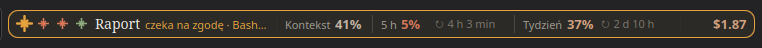

# Claudbar

Your Claude Code sessions on the KDE Plasma 6 panel. See at a glance which session is working, which one is waiting for you and which one has finished, how full its context is, how much of your plan's limits you have used, and what it cost. One click takes you to the chat that needs you.


When a session asks for permission or asks you a question, its spark turns amber and blinks, and the bar gets an amber outline:



A click on the bar opens the list of recent sessions and your limits:


*Unofficial community project, not affiliated with or endorsed by Anthropic.*

## Features

- **A spark per session.** Clay and turning while it works, amber and blinking while it waits for you, red when its turn failed, sage when it is done. The current session's spark is the larger one. Finished sessions fade out after 5 minutes; the latest one stays.
- **Waiting for a background task.** A session whose turn is over but which left something running (tests in a background shell, a subagent, a scheduled wake-up) is not done: it shows as a blue ring with what it waits for (`waiting for a task · 4 min · Run the tests`) until the task wakes it.
- **What the session is doing.** Its name, state and current step (`working · 2 min · Bash: Run the tests`), how many subagents it runs, its context usage and cost. The bar shows the most urgent session: waiting first, then failed, working, waiting for a task, and the latest.
- **Notifications.** A desktop notification when a session starts waiting for you or fails while Claude's window is not in front.
- **Plan limits.** The 5-hour and weekly usage, with the time until each resets. Values turn amber past 80% and red past 95%.
- **One click to the chat.** While a session waits, a click on the bar opens that chat in the Claude desktop app, bringing the window back if it was minimized.
- **The session list.** Sessions from the last 10 minutes (at least 3). Click a row to open its chat, pin a session to the bar, or give it a short name. *Clear* hides the finished ones; sessions still going stay, and so does the latest one when nothing is going.
- **Out of the way.** The widget hides while Claude is closed and takes no space on the panel.

## Install

You need KDE Plasma 6 and Claude Code (the CLI or the desktop app's Code tab). With Python 3 a chat opens instantly; without it Claudbar falls back to `xdg-open`, which takes about a second.

**1. The widget**

```bash
git clone https://github.com/siw0o0/claudbar.git
cd claudbar
./install.sh
```

Right-click the panel, choose *Add Widgets…*, search for **Claudbar** and drag it onto the panel.

**2. The Claude Code plugin** that feeds it

In a terminal session (`claude`):

```
/plugin install claudbar --marketplace siw0o0/claudbar
```

Answer `y` to add the marketplace and pick the user scope. From a shell:

```bash
claude plugin install claudbar --marketplace siw0o0/claudbar
```

In the desktop app, where `/plugin` does not run: click **+** next to the prompt box, then **Plugins**, **Add marketplace** with `siw0o0/claudbar`, then **Add plugin**.

New sessions pick the plugin up. Restart open sessions, or the desktop app, to see them on the panel.

## Settings

Right-click the widget and choose *Configure Claudbar…*

- **Width**: the bar's fixed width on the panel, so it never jumps as names and times change. It never goes below what the meters need; a wider bar shows more of what a session is doing.
- **Compact**: percentages only, without the bars. On a small screen (a laptop's) the bar turns compact and narrower by itself; this can be turned off.
- **Cost**: show or hide the session's API-equivalent cost.
- **Notifications**: notify when a session waits for you or fails.
- **Look**: the Claude style (on by default) with a warm dark bar and list, sparks, serif session names and clay and kraft accents. Turned off, Claudbar follows your Plasma theme and shows plain blue, orange and green dots.

Session names come from the conversation's title (its first words on the bar, all of it in the list), or the project folder until there is a title.

## How it works

Everything stays on your machine.

1. **The plugin** (`mod/`) listens to Claude Code's session events and writes each session's state to `~/.cache/claudbar/sessions/<id>.json` and your plan's limits to `~/.cache/claudbar/usage.json`. It only observes: it never calls the model, so it costs no tokens, and it needs no login or API key.
2. **The widget** (`plasmoid/`) reads those files, and only when their modification times change. It finds the Claude desktop app through its tray icon on D-Bus, and opens chats through the app's `claude://code/continue` links. Terminal sessions have no chat in the app; they show on the bar while they work or wait.

Cost is the API-equivalent price Claude Code reports, not what a subscription charges.

While a session is busy the plugin rewrites its file once a minute. A session whose process died without saying so (a crash, a kill) stops doing that, and the widget drops it after three minutes.

The plugin has tests: `claude plugin test mod`.

## Notes

- **Panel Colorizer** overrides the text colour of panel widgets. To keep Claudbar's colours, add a global override for Claudbar with fallback turned off.
- **Languages**: English, and Polish when the system locale is Polish. Translations live in `plasmoid/contents/ui/tr.js`; a new language is one more catalog there.

## Uninstall

```bash
./install.sh remove
```

Then run `/plugin uninstall claudbar` in Claude Code. You can delete `~/.cache/claudbar`.

## License

Claudbar is free software: you can redistribute it and/or modify it under the terms of the GNU General Public License as published by the Free Software Foundation, either version 3 of the License, or (at your option) any later version. See [LICENSE](LICENSE).

Copyright (C) 2026 siw0o0
