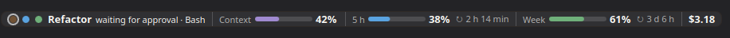
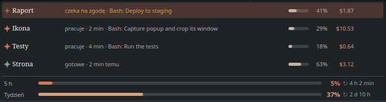

# Claudbar

A KDE Plasma 6 panel widget that shows what your Claude Code sessions are doing: one coloured dot per session, the current session's state, context usage, your plan's 5-hour and weekly limits, and cost. It stays hidden while Claude is closed.





*Unofficial community project, not affiliated with or endorsed by Anthropic.*

## What it shows

- **Dots**: one per session. Blue means working, orange (blinking) means waiting for you (a permission prompt, or a question the session asked), green means done. Finished sessions fade out after 5 minutes; the latest one stays.
- **The session on the panel**: its name, state and current tool (`working · Bash · 2 min`), context window usage and cost. By default it shows the most urgent session (waiting, then working, then the latest).
- **Limits**: the plan's 5-hour and weekly usage with time to reset.
- **A click on the bar**: while a session waits for you, it opens that chat in the Claude desktop app right away (the pinned session if it is the one waiting, else the latest waiting one). Otherwise, or when the waiting session has no chat in the app (a terminal session), it opens the list.
- **The list**: sessions active in the last 10 minutes, at least 3. Click a row to open that chat in the Claude desktop app (through its `claude://code/continue` link, handed straight to the running app, so it switches at once; terminal sessions have no chat to open). If the app is minimized, KWin brings its window back and focuses it. The buttons on the right of a row pin the session to the panel (click again to unpin) and give it a short name. The **Compact** switch at the bottom hides the bars on the panel and keeps only the percentages (coloured when they pass 80%).

Session names come from the conversation's title (its first meaningful word), or the project folder when there is no title yet.

## How it works

Two parts, both local:

1. **A Claude Code mod** (`mod/`) hooks session events and writes each session's state to `~/.cache/claudbar/sessions/<id>.json` and the plan's limits to `~/.cache/claudbar/usage.json`. It only observes; it never calls the model, so it costs no tokens, and it needs no login or API key.
2. **A Plasma widget** (`plasmoid/`) reads those files. It notices changes by checking file modification times inside Plasma and reads the files with one `awk` call only when something changed. It finds the Claude desktop app through its tray icon on D-Bus and hides when the app quits. Terminal sessions show while they are working or waiting.

Cost is the API-equivalent price Claude Code reports, not what a subscription charges.

## Install

Requirements: KDE Plasma 6, and Claude Code (the CLI or the desktop app's Code tab). Python 3 makes opening a chat instant; without it the widget falls back to `xdg-open`, which takes about a second.

**1. The widget**

```bash
git clone https://github.com/siw0o0/claudbar.git
cd claudbar
./install.sh
```

Then right-click the panel, choose *Add Widgets…*, search for **Claudbar** and drag it onto the panel.

**2. The Claude Code mod**

At the prompt of a terminal session (`claude`):

```
/plugin install claudbar --marketplace siw0o0/claudbar
```

Answer `y` to add the marketplace, then pick the user scope. From a shell instead:

```bash
claude plugin install claudbar --marketplace siw0o0/claudbar
```

In the desktop app, where `/plugin` does not run: click **+** next to the prompt box, then **Plugins**, **Add marketplace** with `siw0o0/claudbar`, then **Add plugin**.

New sessions pick the mod up; restart open ones (or the desktop app) to see them on the panel.

## Uninstall

```bash
./install.sh remove
```

and `/plugin uninstall claudbar` in Claude Code. `~/.cache/claudbar` can be deleted.

## Languages

The interface is in English, with Polish when the system locale is Polish. Translations live in `plasmoid/contents/ui/tr.js`; adding a language is one more catalog there.

## License

MIT
